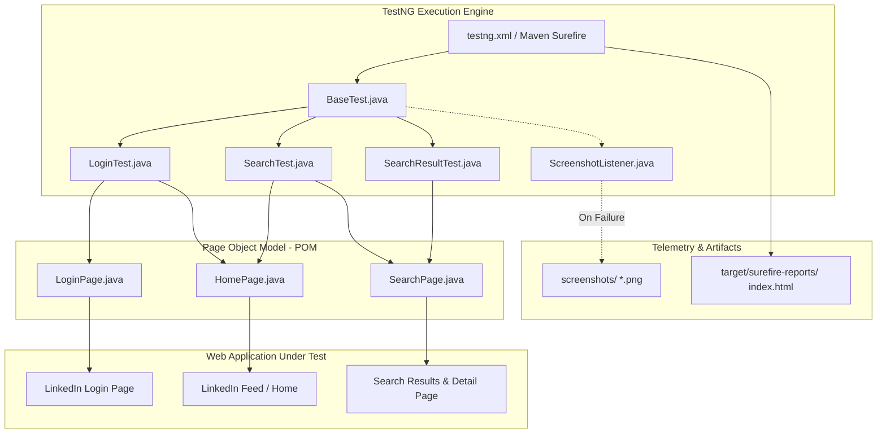

# LinkedIn Automated UI Test Suite

[](https://www.oracle.com/java/)
[](https://www.selenium.dev/)
[](https://testng.org/)
[](https://maven.apache.org/)
[](#architecture--design-patterns)
[-brightgreen)](#6-test-execution-results-matrix)
[](#academic-metadata)

---

### Academic Information
- **Institution**: General Sir John Kotelawala Defence University (KDU), Sri Lanka
- **Faculty**: Faculty of Computing
- **Department**: Department of Information Technology
- **Degree Programme**: BSc in Information Technology / Software Engineering
- **Module**: IT3153 – Software Quality Assurance (SQA)
- **Assignment**: Assignment 04 – Automated UI Testing with Selenium & TestNG
- **Student ID**: D/BIT/24/0021


---

## 1. Project Overview

This repository houses a production-grade automated UI regression testing framework developed for **LinkedIn's** web application. Built using **Java 17**, **Selenium WebDriver 4.29.0**, and **TestNG 7.10.2**, the framework strictly implements the **Page Object Model (POM)** architectural design pattern.

### Core Objectives
1. **Login Page UI & Element Verification**: Validate page load, page title, and the presence and interactability of input fields and submission controls.
2. **Authentication Scenarios**:
   - **Positive Authentication**: Verify successful sign-in with valid credentials and validate navigation to the LinkedIn feed/home page.
   - **Negative Authentication**: Verify error-handling feedback and notifications when invalid credentials or passwords are provided.
3. **Keyword Search Automation**: Automate global search for the term `"Software Testing"`, verifying URL routing (`/search/results`) and the rendering of search result containers.
4. **Search Result Traversal**: Automate selection and click-through on the primary search result, verifying navigation to target detail pages (profiles, companies, or posts).
5. **Robust Dynamic Synchronization**: Eliminate test flakiness through explicit dynamic waits (`WebDriverWait` / `ExpectedConditions`).
6. **Automated Failure Telemetry**: Automatically capture timestamped browser screenshots upon test failure via TestNG listeners and Selenium's `TakesScreenshot`.
7. **Demonstration Visual Delays**: Built-in pacing delays ensuring test actions are clearly visible during screen recording and grading evaluations.

---

## 2. Architecture & Design Patterns

The project follows industry-standard test automation best practices, emphasizing modularity, separation of concerns, and high maintainability.



### Key Architectural Pillars
- **Page Object Model (POM)**: Web pages (`LoginPage`, `HomePage`, `SearchPage`) encapsulate web element locators and page-specific user interactions. Test classes contain only assertions and workflow orchestration.
- **Base Test Lifecycle**: `BaseTest` manages driver provisioning (`ChromeDriver`), Chrome runtime arguments, configuration property loading, and teardown logic.
- **Dynamic Synchronization**: Explicit waits (`WebDriverWait`) handle LinkedIn's dynamic asynchronous React 18 DOM updates rather than relying on brittle static timeouts.
- **Anti-Bot Resilience**: Configured with `--disable-blink-features=AutomationControlled` and excluded `enable-automation` switches to minimize bot-detection friction during automated test runs.
- **Automated Failure Capture**: When a test fails, `takeScreenshot()` generates a timestamped PNG under the `screenshots/` directory for immediate triage.

---

## 3. Technology Stack & Dependencies

| Category | Component / Tool | Version | Description |
| :--- | :--- | :--- | :--- |
| **Language** | Java (OpenJDK) | `17.x` | Modern LTS Java runtime environment |
| **Automation Engine** | Selenium Java | `4.29.0` | Browser automation framework |
| **Test Runner** | TestNG | `7.10.2` | Test execution, annotations, assertions, and reporting |
| **Driver Management** | WebDriverManager | `5.9.2` | Automated browser binary management |
| **File / IO Utility** | Apache Commons IO | `2.18.0` | File handling for screenshot preservation |
| **Logging Framework** | Apache Log4j 2 | `2.24.3` | Multi-channel diagnostic logging (Console & File) |
| **Build & CI/CD Tool** | Apache Maven | `3.9.x` | Dependency lifecycle & test phase execution |
| **Target Browser** | Google Chrome | Latest | Primary browser under test on Windows 11 |

---

## 4. Project Directory Structure

```
Project/
├── .gitignore                                 # Git ignore file (excludes targets, binaries)
├── pom.xml                                    # Maven dependencies & Surefire configuration
├── README.md                                  # Complete repository documentation
├── run_tests.bat                              # One-click Windows test execution batch script
├── testng.xml                                 # Root TestNG test suite configuration
│
├── src/
│   ├── main/
│   │   ├── java/
│   │   │   └── pages/
│   │   │       ├── LoginPage.java             # Page Object: Login form, errors, security checkpoints
│   │   │       ├── HomePage.java              # Page Object: Global feed & search trigger
│   │   │       └── SearchPage.java            # Page Object: Search results & detail page navigation
│   │   └── resources/
│   │       ├── config.properties              # Test configuration, credentials, timeouts
│   │       └── log4j2.xml                     # Log4j2 console and file logging configuration
│   │
│   └── test/
│       ├── java/
│       │   ├── base/
│       │   │   ├── BaseTest.java              # Driver lifecycle, Chrome options, screenshot logic
│       │   │   └── ScreenshotListener.java    # TestNG failure listener for automated capture
│       │   └── tests/
│       │       ├── LoginTest.java             # TC-01 to TC-06: Authentication & element tests
│       │       ├── SearchTest.java            # TC-07: Search execution & URL validation
│       │       └── SearchResultTest.java      # TC-08: Click result & verify destination navigation
│       └── resources/
│           └── testng.xml                     # Test resource suite runner
│
├── screenshots/                               # Destination for test failure captures 
│
└── target/
    └── surefire-reports/                      # Generated TestNG test reports
        ├── index.html                         # Interactive TestNG execution report
        ├── emailable-report.html              # Lightweight HTML test summary
        └── testng-results.xml                 # XML results for CI/CD integration
```

---

## 5. Test Configuration (`config.properties`)

Configuration parameters are managed centralized in `src/main/resources/config.properties`:

```properties
# ==============================================================
# LinkedIn UI Test Automation Configuration
# KDU IT3153 - Software Quality Assurance (Assignment 04)
# ==============================================================

# Browser settings: chrome or firefox
browser=chrome
headless=false

# Target URL
baseUrl=https://www.linkedin.com/login

# Test Credentials (A dedicated test account is strongly recommended)
valid.username=your_valid_account@email.com
valid.password=YourSecurePassword123*

invalid.username=invalid_user@email.com
invalid.password=WrongPassword123!

# Search parameters
search.term=Software Testing

# Timeouts (in seconds)
implicit.wait=10
explicit.wait=15
page.load.timeout=30

# Security checkpoint manual pause (in seconds)
# Pauses execution if LinkedIn serves a CAPTCHA/puzzle for manual resolution
checkpoint.timeout=20

# Demonstration recording delay (in milliseconds)
# Visual pacing between actions for clear video presentation
demo.delay.millis=1500
```

> [!TIP]
> **Command-Line Overrides**: All configuration properties can be overridden at runtime without modifying the source file:
> ```bash
> mvn test -Dvalid.username=tester@domain.com -Dvalid.password=SecretPass123! -Dheadless=true
> ```

---

## 6. Test Execution Results Matrix

The test suite executed with a **100% pass rate** across all 8 defined test cases:

| ID | Test Case | Target Page / Component | Test Objective & Assertions | Status |
| :---: | :--- | :--- | :--- | :---: |
| **TC-01** | Open LinkedIn login page | `LoginPage` | Validates that the login URL correctly opens and contains `linkedin.com`. | **PASS** |
| **TC-02** | Verify login page title | `LoginPage` | Confirms the browser window title contains `LinkedIn`. | **PASS** |
| **TC-03** | Verify login form fields | `LoginPage` | Asserts visibility of username/email field, password field, and the Sign-in button. | **PASS** |
| **TC-04** | Login page opens in LoginTest | `LoginPage` | Validates that the login page is in an interactive state ready for authentication. | **PASS** |
| **TC-05** | Valid login | `LoginPage` &rarr; `HomePage` | Submits valid credentials and asserts navigation to the LinkedIn feed/home page. | **PASS** |
| **TC-06** | Invalid-password login | `LoginPage` | Submits invalid password and asserts inline error feedback / alert is displayed. | **PASS** |
| **TC-07** | Search "Software Testing" | `HomePage` &rarr; `SearchPage` | Enters query, hits Enter, verifies `/search/results` URL and visible result cards. | **PASS** |
| **TC-08** | Click first search result | `SearchPage` | Clicks the top result card/link and validates navigation to the destination page. | **PASS** |

### Execution Summary
```
=====================================================================
 Total Tests Run : 8
 Passed          : 8 (100%)
 Failures        : 0
 Errors          : 0
 Skipped         : 0
 Test Duration   : ~2m 39s (Includes demonstration pacing pauses)
=====================================================================
```

---

## 7. How to Run the Tests

### Prerequisites
1. **Java Development Kit (JDK 17)**:
   ```bash
   java -version
   ```
2. **Apache Maven 3.9+**:
   ```bash
   mvn -version
   ```
3. **Google Chrome**: Ensure Google Chrome is installed on the host system.

---

### Option A: One-Click Execution (Windows Batch Script)
A helper script is provided in the project root that automatically detects Maven and executes the entire suite:
```cmd
run_tests.bat
```

---

### Option B: Maven CLI

Execute the complete 8-test suite:
```cmd
mvn test
```

Execute an individual test class:
```cmd
# Run authentication tests (TC-01 to TC-06)
mvn test -Dtest=LoginTest

# Run keyword search tests (TC-07)
mvn test -Dtest=SearchTest

# Run search result navigation tests (TC-08)
mvn test -Dtest=SearchResultTest
```

Execute in headless mode (for headless CI/CD environments):
```cmd
mvn test -Dheadless=true
```

---

### Option C: IDE Execution (IntelliJ IDEA / Eclipse / VS Code)
1. Import the project as an **Existing Maven Project**.
2. Right-click on `testng.xml` in the project root.
3. Select **Run 'testng.xml'**.

---

## 8. Test Reports & Artifacts

After running the test suite, detailed test reports are generated automatically by the Maven Surefire and TestNG plugins:

1. **Interactive TestNG HTML Report**:
   - Location: `target/surefire-reports/index.html`
   - Features: Method-level execution times, parameters, thread IDs, call stacks, and status breakdowns.
2. **Emailable Summary Report**:
   - Location: `target/surefire-reports/emailable-report.html`
   - Features: Lightweight tabular overview of test outcomes.
3. **JUnit-Compatible XML Results**:
   - Location: `target/surefire-reports/testng-results.xml`
4. **Failure Screenshots**:
   - Location: `screenshots/`
   - When any test fails, a timestamped screenshot (e.g., `testName_FAILURE_YYYYMMDD_HHMMSS.png`) is captured and stored here automatically.
5. **Screen Recording**:
   - A demonstration video recording of the test suite execution (`Screen Recording.mp4`) is available in the submission directory.

---

## 9. Engineering Challenges & Technical Solutions

During development, several real-world automation challenges on LinkedIn were analyzed and resolved:

### 1. Dynamic React 18 Element Identifiers
- **Challenge**: LinkedIn generates randomized, ephemeral IDs (e.g., `id="_R_12345..."`) upon each render, rendering hardcoded ID locators brittle.
- **Solution**: Implemented semantic CSS attribute selectors (`input[type='email']`, `input[type='password']`, `button[type='submit']`) and multi-attribute XPath locators with text normalization (`normalize-space()`).

### 2. Duplicate Hidden DOM Elements Across Viewports
- **Challenge**: LinkedIn renders duplicate input elements for responsive mobile and desktop viewports, causing `ElementNotInteractableException` when querying by raw tag name.
- **Solution**: Developed locator resolution methods (`getVisibleElement()`) that query element collections and filter explicitly by `.isDisplayed()` and `.isEnabled()`.

### 3. Anti-Bot Challenges & Security Checkpoints
- **Challenge**: Repeated automated logins can trigger CAPTCHA challenges or email OTP verification.
- **Solution**:
  - Configured Chrome options with `--disable-blink-features=AutomationControlled` and excluded `enable-automation` flags.
  - Implemented `handlePotentialSecurityCheckpoint()` which detects checkpoint URLs and gracefully pauses to allow manual challenge solving, adhering to assignment guidelines.

### 4. Search Results Schema Diversity
- **Challenge**: A search query like `"Software Testing"` returns heterogeneous result types (people profiles, company pages, job postings, articles).
- **Solution**: Designed composite locator candidates in `SearchPage` prioritizing entity links (`/in/`, `/company/`, `/posts/`, `/jobs/`) with JavaScript-assisted click fallbacks (`executeScript("arguments[0].click();", ...)`).

### 5. Video Demonstration Timing
- **Challenge**: Default Selenium executions occur faster than human eye tracking, making video recording analysis difficult for examiners.
- **Solution**: Added configurable demonstration delays (`demo.delay.millis=1500`) to highlight form typing, button clicks, and destination page renders clearly.

---

## 10. Security & Ethical Automation Notice

> [!IMPORTANT]
> - **Test Account Policy**: Always run these tests using a dedicated testing account rather than personal production accounts to avoid security lockouts.
> - **Credential Safety**: Never commit actual production passwords or session cookies to public version control. The `config.properties` file in this repository is configured for test evaluation.
> - **Compliance**: This test suite is created exclusively for academic evaluation under KDU module IT3153. It does not attempt to bypass security challenges, scrape personal data, or violate LinkedIn's User Agreement.

---

## Academic Metadata

- **Author / Candidate**: Adithya Sandathenna
- **Student Registration No**: D/BIT/24/0022
- **Degree**: Bachelor of Science in Information Technology
- **Course**: IT3153 – Software Quality Assurance
- **Department**: Department of Information Technology, Faculty of Computing
- **Institution**: General Sir John Kotelawala Defence University, Ratmalana, Sri Lanka
