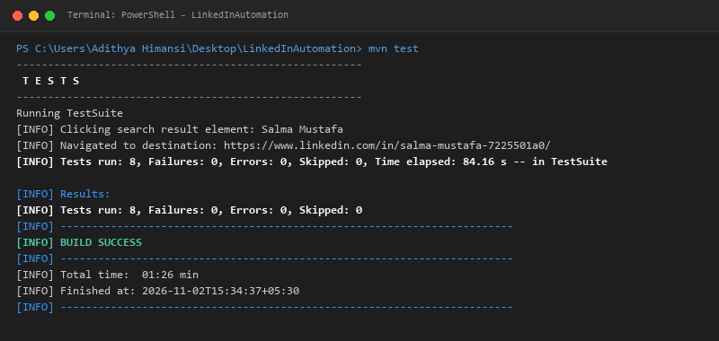

# Department of Information Technology
### Faculty Of Computing &ndash; General Sir John Kotelawala Defence University
**IT3153 &ndash; Software Quality Assurance (SQA) - Assignment 04**  
**Student ID:** D/BIT/24/0022  

---

# LinkedIn UI Automation Testing Report

## 1. Introduction
This project automates selected user-interface checks on LinkedIn using Selenium WebDriver with Java and TestNG, managed through Maven. The tests focus on the login page, login scenarios, search functionality, and navigation from search results. Page classes separate page interactions from test methods following the Page Object Model (POM) architectural design pattern.

## 2. Objectives
- Verify that the LinkedIn login page opens and displays expected page elements.
- Exercise valid-login and invalid-password scenarios using environment-based credentials.
- Search for "Software Testing" and verify a search-results URL and visible results.
- Click a search result and verify navigation to a result destination.
- Capture browser screenshots automatically when a registered TestNG test fails.

## 3. Tools and Environment

| Tool | Purpose |
| :--- | :--- |
| **Java 17** | Programming language and test runtime environment. |
| **Selenium WebDriver (4.29.0)** | Browser automation and interaction with page elements. |
| **TestNG (7.10.2)** | Test methods, lifecycle integration, assertions, and test result reporting. |
| **Apache Maven (3.9.9)** | Dependency management and command-line test execution. |
| **Chrome / ChromeDriver** | Browser under test and automation driver running on Windows 11. |

---

## 4. Test Cases and Execution Results
The latest recorded Maven/TestNG run completed successfully. The aggregate counts below are taken from the project's Surefire report (`TestSuite.txt`) and terminal output.

| ID | Test case | Expected result | Status |
| :--- | :--- | :--- | :--- |
| **TC-01** | Open LinkedIn login page | Login page loads with valid URL. | **Pass** |
| **TC-02** | Verify login page title | Expected title "LinkedIn" is available. | **Pass** |
| **TC-03** | Verify login form fields | Username, password, and sign-in controls are visible. | **Pass** |
| **TC-04** | Login page opens in LoginTest | Login page is displayed and interactable. | **Pass** |
| **TC-05** | Valid login | Login completion is detected and feed loads. | **Pass** |
| **TC-06** | Invalid-password login | Invalid-credential feedback is detected. | **Pass** |
| **TC-07** | Search "Software Testing" | Search results URL and visible result are detected. | **Pass** |
| **TC-08** | Click first search result | Navigation to a result destination is verified. | **Pass** |

## 5. Overall Test Result

| Tests run | Failures | Errors | Skipped | Elapsed |
| :---: | :---: | :---: | :---: | :---: |
| **8** | **0** | **0** | **0** | **84.16 seconds** |

## 6. Page Object Model and Locator Strategy
The project separates browser setup in `BaseTest`, page interactions in `LoginPage`, `HomePage`, and `SearchPage`, and assertions in test classes. This follows the Page Object Model approach and helps reduce duplicated page-interaction code while improving maintainability. CSS selectors and XPath expressions locate fields, buttons, and result links. Explicit dynamic waits (`WebDriverWait` with `ExpectedConditions`) are used for all element visibility, clickability, and URL navigation conditions rather than arbitrary static thread sleep.

---

## 7. Failure Screenshot Handling
`BaseTest` implements automated screenshot capture via Selenium's `TakesScreenshot` and responds to any test failure by attempting to capture the current browser window state. It creates a `screenshots/` directory and saves a timestamped PNG file. The handler is automatically invoked during teardown if a test fails so that issues can be diagnosed quickly. Successful runs do not create failure screenshots, avoiding unnecessary storage clutter.

*Figure 1: VS Code screenshot showing the latest aggregate TestNG results.*

## 8. Challenges and Limitations
- **Dynamic React 18 Element IDs:** LinkedIn dynamically generates randomized alphanumeric element IDs (e.g., `id="_R_..."`) on login forms. Hardcoded ID locators were replaced with semantic CSS attribute selectors (`input[type='email']`, `input[type='password']`, `button[type='submit']`).
- **Duplicate Hidden DOM Elements:** LinkedIn renders duplicate hidden input tags across viewports. Without explicit visibility filtering (`element.isDisplayed()`), Selenium triggers `ElementNotInteractableException`.
- **Security Checkpoints & Bot Detection:** LinkedIn automated sessions may trigger security verification or CAPTCHA challenges. Following ethical guidelines and assignment rules, the framework detects `/checkpoint/` and pauses for manual user verification rather than attempting programmatic circumvention.
- **Feed-Based Search Result Variations:** General queries like "Software Testing" return varied entity cards (posts, profiles, companies, jobs). Locators were designed to identify target links and buttons dynamically.
- **Browser & Selenium DevTools Protocol (CDP) Warnings:** Google Chrome updates regularly, creating non-fatal CDP version warnings with Selenium 4.29.0, which do not disrupt test execution.

## 9. Security and Ethical Considerations
Run tests only with an account you own or are authorized to use. Supply credentials through configuration files or environment variables rather than hard-coding them in test scripts. Do not commit sensitive credentials or session tokens to public source control. Review and redact screenshots if they expose personal information. Do not attempt to bypass CAPTCHA or automated security checkpoints.

## 10. Conclusion
The latest recorded test execution completed with eight tests run and no failures, errors, or skipped tests. The project successfully demonstrates browser setup and teardown, login-page checks, valid and invalid login scenarios, search-result verification, navigation checking, and failure screenshot support.
